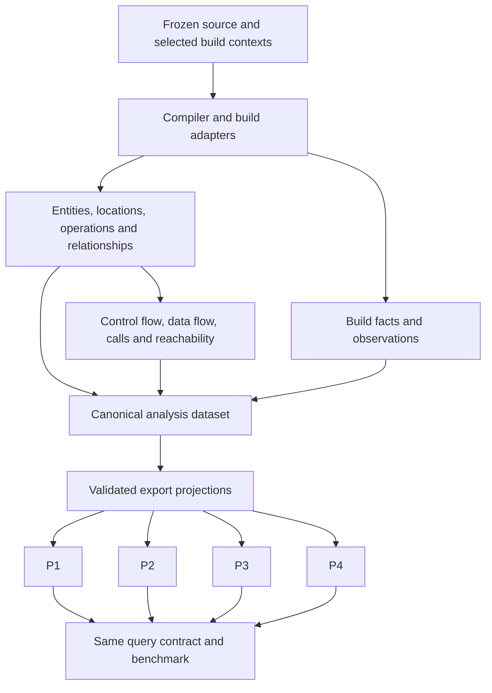

Build an executable that captures a specified C++ or C# codebase, records its source and build context, extracts structured facts and analysis results, and produces four comparable export profiles from one completed analysis dataset. Provide focused queries so an AI can retrieve relevant evidence without reading the entire database.

**Status: proposed implementation baseline.** The scope includes BD0, BDG, and BDB. Application runtime observation, BDR, remains deferred. The earlier inventory is a requirements reference, not proof that every field is recoverable or that the implementation is complete.

The [complete original information inventory](https://chatgpt.com/space/page_477a6bc92bbc819192d77a641cb836df) is an integral annex: all 33 sections, their sub-elements, ownership rules, and verification conditions remain in scope. The clarifications below govern the proposed implementation where the earlier wording was ambiguous. A section appearing in the schema does not by itself mean its extractor has been implemented.

# Vocabulary and scope

An **inventory section**, also called an **information category**, is a numbered description such as BD0.7. An **extraction module** is code that produces information. An **export profile** selects which information to deliver. A **query view** selects what a reader sees for a question. These are separate concepts: one module can supply several sections, and several modules can contribute to one section.

| Label | Meaning |
|---|---|
| BD0 | Detailed source entities, their relationships, and static analysis results |
| BDG | Organizational groups and derived views at file, directory, namespace, project, or solution level |
| BDB | Build contexts, definitions, selected dependencies, actions, observations, and artifacts |
| BD0.7 | The structure of code inside bodies and initializers: statements, expressions, semantic operations, and their ordering and nesting |
| BD0.12 | Control flow: possible transitions between blocks of operations |
| BD0.13 | Data flow: how writes, reads, arguments, returns, and shared storage may influence one another |

A record describes one identified subject or fact. For example, an analysis has a run record for its settings and outcome, a result record for its analyzed scope, and individual finding records for its conclusions. A record does not need a human name. Fields depend on the kind of record; names, locations, and statuses were examples, not an exhaustive record format.

The system describes declared entities and possible behavior under explicit assumptions. It does not enumerate all future template instantiations, all complete execution routes, or every possible runtime value. A resolved symbol is not necessarily a uniquely determined runtime implementation.

# Proposed architecture

Use one local SQLite database for each exported profile, with typed records and relationships. BD0, BDG, and BDB are logical areas within its schema. Keep immutable source contents in a separate archive shared by the profiles. Use a bounded query API over SQL; use recursive queries for appropriate graph traversals. Introduce a server database or specialist graph engine only if measured concurrency or traversal requirements justify it.

Use compiler and build adapters behind a common intermediate representation: Roslyn for C#, a Clang based adapter for C++ subject to an MSVC compatibility check, and MSBuild based context acquisition for the Visual Studio 2022 pilot. CMake and other build systems remain represented by the inventory; their adapters require separate declared support. The schema must distinguish source syntax from semantic operations and compiler lowering rather than treating them as identical trees.

This is a dependency overview, not a requirement for a single linear algorithm. Call-target and data-flow analysis may refine one another. Persist each analysis version and its dependencies so intermediate and final results cannot be mistaken for the same result.

## Storage contracts

The schema must contain distinct families for snapshots and source blobs; files and file versions; build contexts and compilation units; entities and appearances; structured types and signatures; bodies and operations; relationships and occurrences; analysis runs, results and findings; groups and view definitions; build actions, executions and artifacts; evidence, diagnostics and coverage; and export manifests and reference availability.

Use explicit types, foreign keys, uniqueness constraints, and enumerations for shared concepts. Reserve versioned JSON extensions for language or tool details that do not fit shared fields. A JSON extension must have a named schema and must not replace required normalized fields merely to avoid specifying them.

For every inventory field, the implementation specification must state its meaning, value type, units, multiplicity, ordering, applicability, missing-value states, producer, owner, evidence, and validation rule. For every relationship, specify its permitted endpoint kinds and direction. Phase M0 produces this field dictionary and schema contracts before the corresponding storage code is written.

## Source and identity rules

1. A snapshot records exact original bytes, including local changes and captured generated inputs. A content fingerprint identifies bytes for verification and deduplication; it is not a file identity or a semantic entity identity. Different files with identical contents remain different file records.

2. A source location uses a file-version ID and zero-based byte offsets `[start, end)` into those bytes. Retain encoding and byte-order information. Convert compiler locations explicitly; for example, Roslyn character offsets cannot be used as byte offsets. Validate offsets against retained bytes. Generated text receives a retained virtual file version.

3. Source retrieval returns the matching bytes or decoded text with its encoding and file hash. It never silently substitutes the current working file. A span alone contains coordinates, not the text at those coordinates.

4. Entity identity follows language and compilation rules. Overloads remain distinct; C# partial declarations join within the same compilation; shared C# source in distinct assemblies can define distinct entities. C++ redeclarations, linkage and translation units require explicit reconciliation. Failed reconciliation produces a diagnostic, not a name-based merge.

5. IDs remain identical across profiles of the same canonical dataset. Cross-snapshot correspondence is a separate relationship supported by evidence; unchanged names do not establish it.

6. A member links to the type declaring it. Inheritance, interface implementation and overrides are explicit relationships. An inherited-members query follows those links without copying definitions.

7. Implicit operations retain their causing construct, owning body, semantic role and applicable execution point. They do not receive invented source text. A semantic operation is not a promise that a separate machine instruction or call will be emitted.

8. Distinguish source roots, the selected root of a directory view, and reachability roots. They mean collection boundaries, a grouping origin, and starting entities respectively.

## Context and evidence rules

Every fact must resolve to its snapshot, applicable contexts and evidence, directly or through a documented owner. Context-independent organizational facts declare that status. Queries default to one snapshot and one selected build context; explicit combined views retain context membership and never create execution paths by joining incompatible alternatives.

External symbol descriptive content remains limited to qualified identity/signature and supplying library name. IDs, source occurrences, contexts and evidence support those references. Do not retain external bodies or expanded external member inventories. Compiler adapters may temporarily read external metadata. Package versions, paths, SDK identities and framework selection belong to BDB.

Keep declared settings, evaluated settings, expected outputs, observed execution, existing artifacts and cache reuse distinguishable. SDK tools belong to BDB tool records; target frameworks and runtime identifiers belong to build contexts; used framework symbols appear at the BD0 external boundary. Observing application execution remains BDR and is deferred.

## Independent completeness states

| Dimension | Required distinction |
|---|---|
| Field knowledge | Known value, including empty or zero; unknown with reason; not applicable; not collected |
| Input selection | Included, excluded by a stated scope rule, or undetermined |
| Extraction or analysis | Complete for its declared coverage; partial; failed; not attempted |
| Export availability | Included; omitted by profile; omitted by selection; omitted by budget |
| Query delivery | Complete result; additional pages available; limited by an explicit query budget |

An exporter must not relabel a known fact as unknown because it was omitted. A partial analysis is never made complete by exporting all its available records. Unsupported constructs and external effects retain explicit locations and reasons. An implementation cannot satisfy a supported feature merely by marking every instance unsupported.

# Four baseline export profiles

All profiles use the same schema version, snapshot, contexts, analyzer settings, analysis results, source archive policy, and queries. All sections other than the three toggles remain included.

| Profile | BD0.7 | BD0.12 | BD0.13 | Omitted sections |
|---|---|---|---|---|
| P1 | Omitted | Omitted | Omitted | BD0.7, BD0.12, BD0.13 |
| P2 | Omitted | Omitted | Included | BD0.7, BD0.12 |
| P3 | Omitted | Included | Included | BD0.7 |
| P4 | Included | Included | Included | None |

This is a useful nested comparison: P1 to P2 measures adding data-flow results; P2 to P3 measures adding control flow when data flow is already present; P3 to P4 measures adding full operation structure when both flow representations are present. It does not measure each section's independent benefit under every combination. If interactions matter, add the remaining four combinations of the three on/off switches for eight profiles in total.

There is no assumed size ordering between data flow, control flow and operations. Their quantities depend on the codebase, context count, representation and analyzer settings. In addition, retained relationships, evidence and build records can be large. Record their sizes even though they remain fixed in this first experiment.

## Extract once and project several times

The executable computes one canonical dataset and then creates all requested projections. It must also support re-exporting an existing dataset without rerunning analysis. It may use temporary intermediate storage; users do not need four separate analyses.

Omitting BD0.7 from the exported database does not mean the compiler adapter can avoid constructing executable structure internally. Data-flow analysis commonly uses control flow. Call resolution and reachability may use the results of either. Thus export exclusions reduce delivered storage and available query detail, but do not by themselves demonstrate reduced extraction CPU time or peak memory.

A later analysis-budget experiment may change which analyses are computed, their scope or precision. Such a run has a different analysis configuration and must be compared separately from the four export-only profiles.

## Cross-section references

Omission removes the selected section's detailed payload. It must not silently delete retained relationships, recompute different call targets, or leave unexplained broken references.

Keep source spans, entity identities, occurrence IDs and minimal reference anchors outside the optional detailed payload. A reference anchor contains the target ID, owning section, minimal kind, applicable scope, source origin when available, and availability. It must not reproduce the omitted tree, flow graph or analysis details. Create anchors only for targets referenced by retained data; do not export an inventory of every omitted node.

For example, a call retained in BD0.14 still identifies its caller, selected declaration or candidate targets, and source location. If its operation tree in BD0.7 is omitted, following that operation reference returns `omitted_by_profile`, with the source origin. BD0.12 can retain block order and references to operation anchors without exporting each operation's full BD0.7 payload. BD0.13 can identify write/read locations without requiring the consumer to load BD0.12.

An ID used by a retained record must resolve to a retained record, an explicit omitted-reference anchor, or an unresolved-reference record. Preserve the distinction between a missing exported explanation and an unresolved semantic target. Where a reachability witness needs omitted detail, retain its reference and report the unavailable detail. Do not invent an alternative proof.

Counts and conclusions in retained sections refer to the canonical analyzed scope. Export coverage separately reports which supporting details are available in that profile. Required reference metadata creates measurable overhead even when a section is omitted.

## Export manifest and files

Each profile contains an `index.sqlite` and `manifest.json`. A shared source archive stores original bytes by content hash. The experiment also produces `comparison.json` and a readable report. A standalone package can include its own copy of required source blobs; shared storage and standalone package sizes must be reported separately.

The manifest records schema and vocabulary versions, snapshot and context IDs, canonical dataset fingerprint, analysis run references, profile definition, source availability, section inclusion, record and unit counts, size limits, omissions and reasons, analysis coverage, export outcome, and measured file sizes. It includes the normalized configuration and its fingerprint. Wall-clock timestamps are operational metadata and are excluded from semantic equality checks.

Keep identical table definitions in every profile. Optional payload tables can be empty because the profile omits them; the manifest explains this. Publish a profile only after validation, from staging output, so readers never see half-written records. A failed export must not overwrite a previously valid export. The top-level run report states the outcome of each requested profile and whether all requested outputs were produced.

# Size customization

Provide customization for each of BD0.7, BD0.12 and BD0.13 independently. The four baseline profiles have no export caps on their included sections. A capped variant gets a distinct profile ID and recorded policy; it must not be described simply as P4 with nothing omitted.

There are three different controls: **which code is selected**, **which representation is exported**, and **how much payload may be exported**. Analyzer precision, timeouts and memory budgets are separate controls because they can change conclusions.

| Section | First supported export controls | Unit preserved intact |
|---|---|---|
| BD0.7 | Exact body selection; maximum nodes per body; total node budget; serialized payload byte budget | One complete body or initializer representation |
| BD0.12 | Exact body selection; maximum blocks and edges per body; total block and edge budgets; serialized payload byte budget | One complete control-flow graph for a body |
| BD0.13 | Exact analysis-unit selection; selected result families; maximum findings per unit; total finding budget; serialized payload byte budget | One result family for one declared analysis unit |

BD0.13 result families include definition-to-use links, argument and return mappings, capture effects, shared-storage effects, alias and possible-target facts, and inferred constants or ranges. Every retained family keeps its may/must meaning, assumptions and unknown-boundary information. An analysis unit can be a body, a group of mutually dependent bodies, or a larger declared scope; it must not be split arbitrarily if that would alter the result's meaning.

The first implementation omits whole units that exceed a limit. It does not cut a tree or graph halfway and present the remainder as complete. An optional later outline representation must define its own schema and mark elided regions explicitly; it cannot replace full BD0.7 unnoticed.

## Exact limit behavior

- A limit is either an explicit nonnegative integer or `unlimited`. Zero admits no optional payload units. Negative values and unknown setting names are configuration errors. Disabled sections cannot also request nonempty payload selections.

- Selection uses exact context and body or analysis-unit IDs. An absent selection means every eligible unit; an empty list means none. Unknown IDs are configuration errors. File and project selectors, if later added, must resolve to an explicit unit list recorded in the manifest.

- Apply result-family selection first. Process remaining units in bytewise ascending order of their stable unit key. For each unit, include it only if all its per-unit and remaining section budgets permit it. Otherwise record the reason and continue to later units. This is a deterministic selection policy, not a representative sample.

- Each node, block, edge or finding counts once by its canonical record ID in that section. Mandatory headers and anchors are measured separately. A unit with an incomplete analysis remains visibly incomplete even when all its computed records fit the export budget.

- Define a payload byte budget over a versioned canonical serialization: UTF-8 JSON Lines, fixed field order, no optional whitespace, LF terminators, and specified number and string escaping. Count actual serialized bytes before admitting a unit. Specify this serializer in M0; do not approximate from character counts.

- Required identities, source origins, coverage and reference availability are never silently removed to satisfy a payload cap. Report their additional size. SQLite pages, indexes, source contents and packaging overhead are outside the optional payload cap, so it is not a promised maximum database or package size.

- Every omission has a reason and a count. If a total was not computed, report it as unknown. Never substitute zero for an unmeasured total.

Query response limits are a fourth, separate concern. A full stored database can return a short paginated answer without deleting stored information. Conversely, pagination cannot recover facts omitted from an export.

# Query contract for AI consumption

Keep SQL inside the query implementation and expose small, typed operations to the AI. Initial operations cover capabilities and coverage, symbol search, entity details, declared and inherited members, relationships and occurrences, callers and callees, executable bodies, control flow, data flow, reachability, source spans, grouped dependencies, and build contexts, actions and artifacts.

Every request binds a profile and a snapshot/context scope. Names are search inputs; IDs select exact entities. Search results must expose enough qualified identity and signature to disambiguate them. Graph queries specify edge kinds, direction, node or result limits, and maximum traversal depth. Cycle handling is mandatory; no endpoint enumerates every complete execution path.

Reachability queries select an existing analysis result or an explicitly configured root policy. A library policy names its externally callable API members or exports, relevant initialization and known callback entry points, and records why each root was selected. A method being public is not by itself proof that all external entry points have been identified. No root set is silently inferred from the first file or method returned by a query.

Every response identifies its profile, scope and schema version; returns readable labels alongside IDs; links evidence and source locations; and distinguishes extraction completeness, export availability and pagination. A missing optional section returns an explicit unavailable response, not an empty result implying that no such facts exist. A cursor is tied to the immutable dataset, profile and query parameters.

The service used by a profile must read only that profile and its declared source archive. It must not answer omitted-section queries by secretly consulting the canonical full database. Source fallback is allowed in the primary benchmark, but its usage is measured. Optional text search supports discovery in names and documentation; vector similarity is not evidence that two entities are identical or that one calls another.

# Implementation stages and exit conditions

Early experiments are part of development. Export generation runs near the end of an executable invocation; evaluating the design starts near the beginning of the project.

| Stage | Concrete deliverable | Exit condition |
|---|---|---|
| M0 Contract and scope | Field dictionary, record and relationship schemas, enum vocabularies, manifests, query examples, fixture expectations, feature support matrix, selected source roots and build contexts | Every inventory item maps to a producer, storage owner, query or evidence path, test, and declared support status; required pilot inputs are specified |
| M1 End to end pilot | Small C# and C++ fixtures through context acquisition, source retention, representative entities, one executable body, control flow, a data-flow family, queries and all four exports | The same question can be answered with cited evidence from each applicable profile; omitted sections are explicit; the first size and AI retrieval comparison is recorded |
| M2 Detailed source and organization | Complete supported source entities, types, locations, docs, preprocessing, generated origins, typed relationships and BDG views | Identity, member, context, grouping and counting fixtures pass; real pilot coverage is reported by feature and region |
| M3 Analysis expansion | Full declared operation coverage, control-flow modeling, declared data-flow families, indirect-call candidates and reachability | Each supported construct and analysis family passes its semantic fixtures; unknown effects remain visible; profile projection and size controls pass |
| M4 Build evidence | Evaluated build details, action graph, generation, run ingestion, artifact inspection and rebuild/reuse evidence | Expected, observed, skipped, cached and unavailable states pass build fixtures; artifact mappings preserve uncertainty |
| M5 Scale and release validation | Representative repository runs, multi-context isolation, reproducibility, incremental invalidation, robust publishing and final comparison report | All required fixture checks pass, target-project support gates are met, omissions have reasons, and measured quality/resource tradeoffs support a profile recommendation |

M1 is a deliberately small vertical slice, not completion of whole sections. Re-run the same benchmark at M2, M3, M4 and M5 where newly available capabilities affect its questions. Avoid optimizing the full architecture before a pilot shows which representations help.

## Inventory traceability

Each row carries all sub-elements from the full inventory annex. The stage column identifies the main expansion stage after the M1 sample. BD0.16 and shared correctness rules apply from the first extraction.

| Section | Information retained | Main stage |
|---|---|---|
| BD0.1 | Exact source collection, fingerprints, immutable contents, roots and exclusions | M1 |
| BD0.2 | Files, paths, encoding, role, origin, virtual generated files and status | M1–M2 |
| BD0.3 | Declarations, definitions, references, byte spans and implicit or macro origins | M2 |
| BD0.4 | Canonical entity identities, containment, modifiers, availability and resolution | M2 |
| BD0.5 | Every declared entity family and member kind, including accessors, locals and template details | M2 |
| BD0.6 | Structured types and complete callable signatures | M2 |
| BD0.7 | Statements, expressions, semantic operations, ordering, types, operands and implicit behavior | M3 |
| BD0.8 | Macros, includes, conditions, inactive code and generated origins | M2 |
| BD0.9 | Documentation, annotations, arguments and documented claims | M2 |
| BD0.10 | Typed relationships and individual occurrences with evidence | M2–M3 |
| BD0.11 | Used external symbol identity/signature and supplying library | M2 |
| BD0.12 | Entry and exit, blocks, ordered operations, transitions, conditions and modeling gaps | M3 |
| BD0.13 | Value sources and uses, arguments and returns, captures, aliases, storage effects and inferred facts | M3 |
| BD0.14 | Call-site resolution, dispatch, candidate implementations and unresolved remainder | M2 direct; M3 indirect |
| BD0.15 | Reachability roots, policies, reachable and outside sets, witnesses and unknown boundaries | M3 |
| BD0.16 | Tool versions, settings, coverage, diagnostics, assumptions and guarantees | M1 onward |
| BDG.1 | Physical and logical grouping objects and membership definitions | M2 |
| BDG.2 | Directory hierarchy, selected root, depth and rollup rules | M2 |
| BDG.3 | Project and solution identities, membership and context links | M1–M2 |
| BDG.4 | Namespaces, modules and IDE folders distinct from physical directories | M2 |
| BDG.5 | View definitions, selected contexts, filters, depth and counting policy | M2 |
| BDG.6 | Group relationships, underlying evidence, deduplication and separate count types | M2 |
| BDG.7 | Summaries, cycles, coverage and freshness tied to underlying inputs | M2–M3 |
| BDB.1 | Build contexts, configuration mappings, framework, architecture and feature selection | M1 |
| BDB.2 | Compiler, toolset, SDK, generator and relevant environment identities | M1–M2 |
| BDB.3 | Original and evaluated definitions, imports, overrides and settings | M1–M4 |
| BDB.4 | Declared, selected and observed file participation and compilation units | M1–M4 |
| BDB.5 | Dependency requests, resolved providers, versions, roles and resolution evidence | M1–M4 |
| BDB.6 | Planned build actions, inputs, outputs and reasoned dependency order | M4 |
| BDB.7 | Generation and transformation inputs, outputs, origins and cache status | M2 source links; M4 build evidence |
| BDB.8 | Build runs, executions, outcomes, logs, timing and cache or skip reasons | M4 |
| BDB.9 | Artifacts, availability, inspection, symbols, binary mappings and mapping gaps | M4 |
| BDB.10 | Rebuild rules, predicted work, actual work, reuse and changed artifacts | M4–M5 |

In M0, subdivide each row into field-level requirements with stable requirement IDs and links to the original inventory wording. Include constraints and examples, not just bullet points naming stored fields. A proposed removal or deferral gets an explicit change entry; it must not disappear in a summary.

# Acceptance checks

The following checks are mandatory in addition to the inventory annex. Passing is evaluated against declared supported features and explicit expected fixture outputs, not against a compiler's total theoretical capabilities.

| Check | Pass condition |
|---|---|
| Inventory accounting | All 33 sections and every annex sub-element have a field-level disposition and test or documented collection prerequisite |
| Snapshot fidelity | Retained bytes match recorded hashes; editing working files does not change old source retrieval; invalid spans are rejected |
| Encoding and origins | UTF-8 multibyte text, UTF-16 input, CRLF, macros, generated files and implicit operations resolve to the intended source constructs |
| Identity and members | Split C++ declarations join correctly; partial C# types join correctly; overloads and distinct assembly entities remain distinct; all fixture members are represented |
| Context isolation | Different conditional branches and dependency versions remain scoped; no path combines incompatible contexts |
| Profile equivalence | For retained sections, canonical semantic records have the same IDs and field values in every baseline profile; availability metadata is the only expected export-dependent difference |
| Reference integrity | Every reference resolves to a retained target or an explicit omitted or unresolved reference; no unexplained dangling ID exists |
| Profile isolation | Requesting omitted operation or flow detail cannot retrieve it through a hidden full-dataset connection |
| Size controls | Boundary cases below, at and above each limit produce deterministic whole-unit inclusion and correct omission reasons; zero and unlimited behave as specified |
| Semantic honesty | May differs from must; candidate sets expose completeness; outside the computed reachable set is not labeled dead code; no runtime values are invented |
| External boundary | External records contain only the permitted descriptive information and supporting references |
| Aggregation | Group totals deduplicate by underlying IDs; pairs, occurrences, contributors and candidate edges are separately counted; root-level files remain visible |
| Build states | Declared, evaluated, expected, observed, skipped and cached facts remain distinguishable; existing output is not attributed to a run without evidence |
| Freshness | Changes to source, effective settings, dependencies or tool versions invalidate affected derived results; old immutable datasets remain identifiable |
| Failure behavior | Unsupported syntax, missing inputs, cancellation, budgets and interrupted export produce explicit outcomes; valid prior exports remain readable |
| Reproducibility | Same canonical dataset and export policy produce identical semantic payloads and omissions, excluding documented operational metadata |

Required semantic fixtures also cover inheritance and overrides, property accessors and overloaded operators, initialization and cleanup, exception edges, async/yield where supported, templates and generic constraints, captures, pointer or reference aliases, indirect calls, unknown callbacks through external code, generated inputs and cache reuse. Test both positive facts and absence claims. Exact expected fixture facts must pass in full; no blanket unknown fallback counts as feature support.

# Size and AI retrieval experiment

Use the same frozen library, contexts and canonical analysis for P1–P4. Include small fixtures first, then representative small, medium and large real libraries where available. Record their actual file, entity, body, operation and context counts rather than defining scale by source bytes alone.

Compare a source baseline with ordinary file search and navigation against each profile with the same source fallback. This answers whether the extracted database adds value in realistic use. A second, separately labeled experiment can disable raw source for all profile arms to measure how far retained structured facts alone suffice. The source archive remains part of storage accounting even when a particular experiment disallows retrieving it.

Start with 24 fixed questions, four in each of six categories: identity and members; code and group dependencies; local implementation behavior; control and data flow; calls and reachability; build and artifact provenance. Include questions whose correct answer is uncertain under the available evidence. Establish expected answers and acceptable evidence before reviewing profile results. Preserve questions across milestones; show unavailable capabilities rather than silently dropping difficult questions.

Keep model version, instructions, input context limit, total token budget, query budget and time limit constant. Use three independent attempts per question and arm for the pilot, reporting variability rather than a single favorable answer. Keep answer grading blind to profile identity where practical. Record model, tool and prompt versions so subsequent reruns are interpretable.

| Dimension | Measurement |
|---|---|
| Stored size | Total database and package bytes; table/index bytes where measurable; section payload bytes and record counts; source and evidence archive bytes; shared versus standalone totals |
| Production cost | Parsing and analysis time, export time, peak memory, canonical temporary storage and incremental update cost |
| Retrieval cost | Query latency, tool calls, records returned, source snippets and source bytes retrieved |
| AI cost | Actual input and output tokens under the selected model tokenizer, time to answer, and monetary cost where known |
| Answer quality | Correct required facts, missing required facts, unsupported claims, correct uncertainty and verifiable citations |
| Navigability | Whether the AI finds the relevant entity, result and evidence within the fixed budgets; failed or repeated searches and unnecessary returned material |

Evaluate whether each additional representation improves answer quality enough to justify its storage and retrieval cost. A shorter export is not automatically easier to use: it can force repeated queries or larger source reads. A larger database is not automatically a larger AI prompt: targeted queries may return only a few records.

Do not promise that one profile wins for every question. Report results by task category and library size. Choose defaults after examining accuracy and resource tradeoffs; preserve the other profiles for tasks that benefit from them. Set project-specific performance thresholds from M1 measurements before M5 acceptance, and record them rather than choosing them after viewing final results.

# Decisions required to start a real extraction pilot

These inputs bound the implementation; they are not reasons to postpone the document or prototype design.

| Input or decision | Proposed starting position | What must be recorded |
|---|---|---|
| Representative code | One small C# and one small C++ fixture, then the user's actual library | Repository or directory and permitted input files |
| Internal boundary | Explicit root list and external/vendor exclusions | Rules for generated, vendored and shared code |
| Build support | Visual Studio 2022 and MSBuild pilot; verify the C++ adapter against the project's MSVC usage | Actual installed versions, language versions, platform, target frameworks and selected configurations |
| Analysis policy | Compiler-resolved direct references plus declared conservative models for indirect or external behavior | Feature matrix, analysis families, assumptions, completeness conditions and resource limits |
| Runtime data | BDR deferred | No application runtime collection required |
| Source availability | Same immutable source archive accessible to every baseline profile | Archive location and retrieval contract |
| Storage and usage | Local SQLite and one producing process; read-only profile queries | Revisit if shared writes or service deployment becomes a requirement |
| Profile limits | Baseline P1–P4 uncapped on included sections | Additional size variants use distinct recorded policies |
| Build evidence collection | Represent all BDB fields; collect observed values only from actual logs or inspections | Which builds, artifacts, logs and inspection tools are supplied or run |
| Release thresholds | All required semantic fixtures must pass; target-project unsupported features are visible | Coverage and performance gates established before release validation |

A support matrix must list features separately for C# and C++, including compiler extensions, macros, templates, exceptions, async and generated code. Unsupported required project features block a claim of full target-project support. Recording a gap is mandatory, but does not automatically make that gap acceptable.

The next implementation deliverable is M0's schema and field dictionary, followed immediately by the small end to end pilot. The full feature inventory remains the destination; the early experiment determines how to package and query it effectively.
